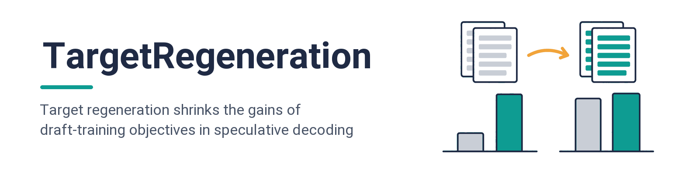
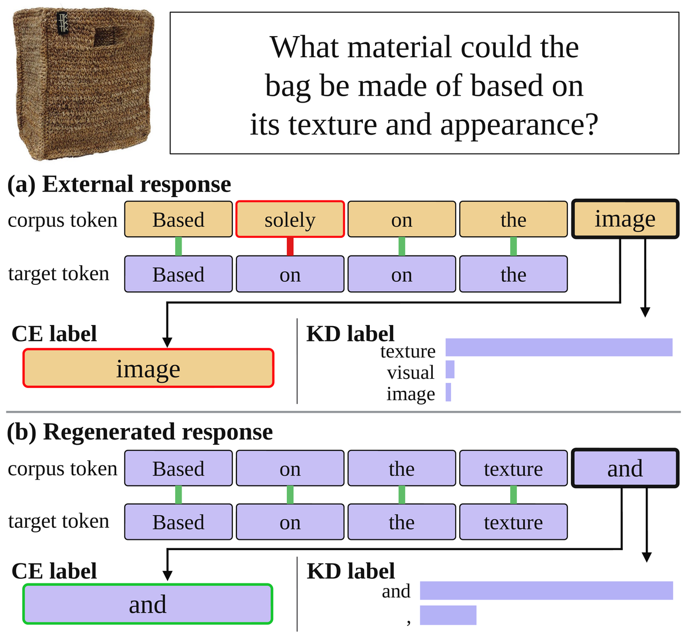
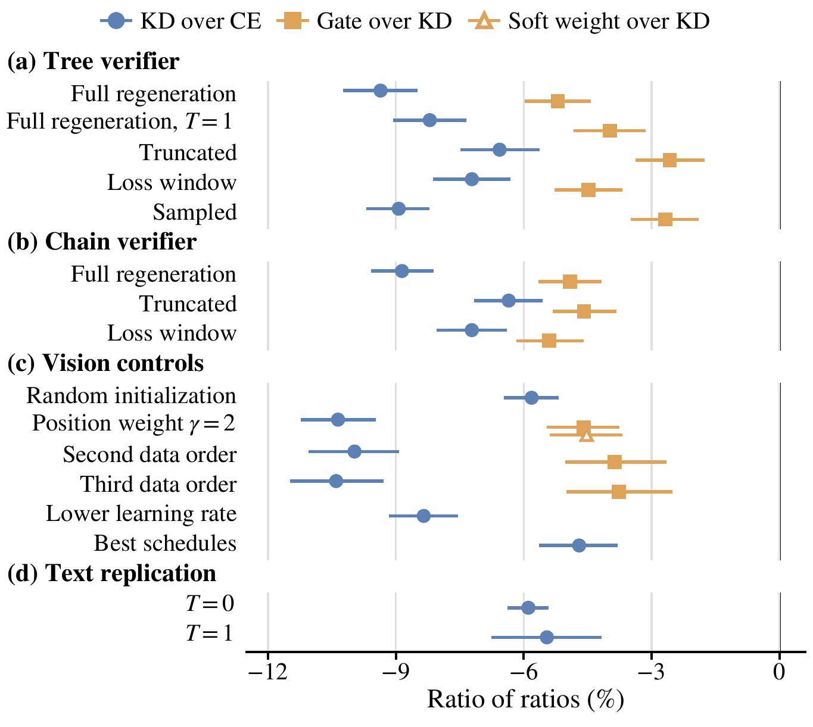
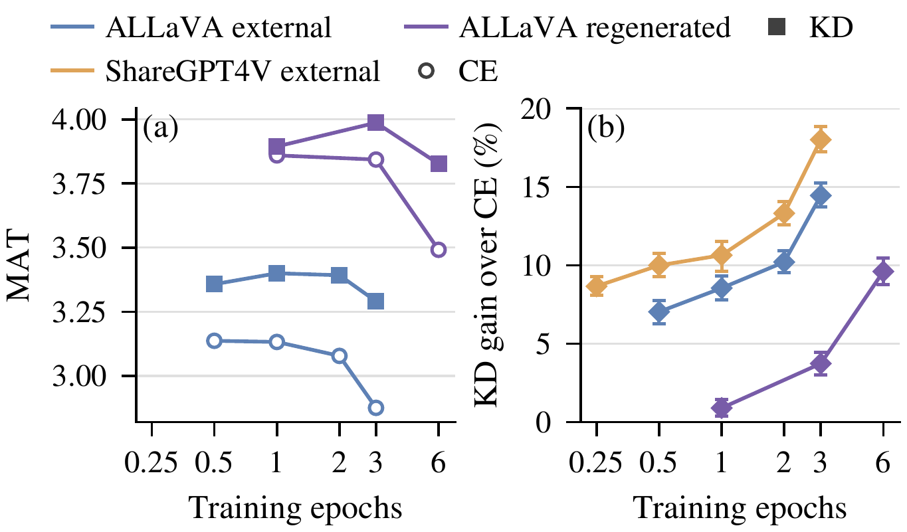

<p align="center">
  
</p>

<div align="center">

[](LICENSE)
[](https://www.python.org/)
[](https://github.com/js-lee-AI/TargetRegeneration/actions/workflows/ci.yml)
[](https://github.com/js-lee-AI/TargetRegeneration/stargazers)

<b><a href="#quick-start">Quick start</a> · <a href="#usage">Usage</a> · <a href="#command-line">CLI</a> · <a href="#results">Results</a> · <a href="#reproduce-the-paper">Reproduce the paper</a> · <a href="#faq">FAQ</a> · <a href="#citation">Citation</a></b>

</div>

---

## News

- **[2026-10-21]** Code released, with the prompt-level acceptance counts behind the vision tables and figures of the paper and the GPU pipeline that regenerates the corpora, trains the drafters and evaluates them.

## Overview

Speculative decoding lets a small drafter propose tokens that the target model verifies in one parallel pass, so the speed-up grows with the mean acceptance length (MAT). New draft-training objectives are usually credited with the MAT they add over cross-entropy (CE) on externally written responses, yet many pipelines first let the target rewrite those responses. The paper asks how much of each gain survives the rewrite, with Qwen3-VL-8B-Instruct as the target and a DFlash block drafter.

Three findings.

* **Regeneration shrinks objective gains.** On external ALLaVA responses, distillation from the target (KD) adds 14.4% MAT over CE, and gating KD to the positions that verification would reach adds a further 4.9%. After greedy regeneration by the target, KD adds 3.7% and the gate no measurable gain.
* **The shrinkage is robust.** It persists across data orders, position weights, verifiers, decoding temperatures and, for KD, initializations and learning rates. Most of it remains at matched supervised length and at each objective's best measured training length, and a second vision corpus and a text-only replication show it too.
* **Gains depend on training length.** On external ALLaVA responses KD's gain over CE grows from 7.1% after a quarter epoch to 14.4% after three, while CE declines after half an epoch, so a gain read at one length can mislead. Objective gains should be measured against a target-regenerated baseline and across training lengths.

This repository is the metrics, the prompt bootstrap and numpy forms of the objectives as a small Python package, the prompt-level acceptance counts behind the vision results, one script for each paper table or figure that rebuilds the printed values from those counts, and the GPU pipeline that regenerates the corpora, builds the response versions, trains the drafters and evaluates them.

## What it does in one picture

<p align="center">
  
</p>

<p align="center"><em>One training example with external (a) and target-regenerated (b) responses (paper Figure 1). Below each corpus token is the target's greedy token, and red marks disagreement. CE trains the outlined slot on its corpus token, KD on the target's distribution. On regenerated responses the corpus already carries the target's greedy token, so KD has less to add.</em></p>

## Quick start

```bash
git clone https://github.com/js-lee-AI/TargetRegeneration.git
cd TargetRegeneration
pip install -e .
python examples/quickstart.py
```

```python
import csv
from collections import defaultdict

import numpy as np

from targetregen import cell, increment, run_mat
from targetregen.bootstrap import PromptBootstrap, ci95

DOMAINS = ("caption", "textvqa", "docvqa")
counts = defaultdict(lambda: {d: ([], []) for d in DOMAINS})  # run -> domain -> (committed, rounds)
with open("data/vision/acceptance.csv", newline="") as fh:
    for row in csv.DictReader(fh):  # sorted by run, domain and prompt
        committed, rounds = counts[row["run"]][row["domain"]]
        committed.append(int(row["committed"]))
        rounds.append(int(row["rounds"]))


def arrays(run):
    """(committed, rounds) of one run as arrays of shape (domains, prompts), for the bootstrap."""
    return tuple(np.array([counts[run][d][i] for d in DOMAINS]) for i in (0, 1))


ce = [f"allava-external-ce-g7-e3-s{seed}-t0" for seed in (0, 1)]  # the two training runs of each cell
kd = [f"allava-external-kd-g7-e3-s{seed}-t0" for seed in (0, 1)]
mat_ce, sd_ce = cell([run_mat(counts[r])[1] for r in ce])
mat_kd, sd_kd = cell([run_mat(counts[r])[1] for r in kd])
print(f"CE {mat_ce:.3f} ±{sd_ce:.3f}, KD {mat_kd:.3f} ±{sd_kd:.3f}")

boot = PromptBootstrap()  # 10,000 prompt resamples within each domain, shared by every run
lo, hi = ci95(boot.cell([arrays(r) for r in kd]) / boot.cell([arrays(r) for r in ce]))
print(f"KD over CE {increment(mat_kd, mat_ce):+.1f}% [{lo:.1f}, {hi:.1f}]")
# CE 2.875 ±0.009, KD 3.291 ±0.008
# KD over CE +14.4% [13.7, 15.2]
```

These are the external ALLaVA cells of paper Table 1, rebuilt from the prompt-level counts in about a second. Without a checkout, `pip install "git+https://github.com/js-lee-AI/TargetRegeneration.git"` installs the package and the `targetregen` command, and `targetregen demo` runs a CPU example on toy numbers.

| to run | install | needs |
|---|---|---|
| the metrics, the bootstrap, the objectives and every script in `experiments/` | `pip install -e .` | Python 3.10+, numpy |
| the tests | `pip install -e ".[test]"` | pytest |
| training and evaluation | `pip install -r pipeline/requirements.txt` | CUDA GPUs, torch 2.9.1, transformers 4.57.6 |
| regeneration | `pip install -r pipeline/requirements-regenerate.txt`, in its own environment | vLLM 0.15.1 |

## Usage

### Metrics and the bootstrap

A verification round commits the draft tokens the target accepts plus the token the target adds itself. A domain's MAT pools rounds over its prompts, a run's MAT is the geometric mean of its domain MATs, and a cell averages its training runs.

```python
from targetregen import mat, run_mat, cell, increment, ratio_of_ratios

mat([30, 12], [10, 6])                  # 2.625: 42 committed tokens over 16 rounds
domains, value = run_mat({"caption": ([20], [10]), "textvqa": ([30], [10]), "docvqa": ([45], [10])})
value                                   # 3.0, the geometric mean of 2.0, 3.0 and 4.5
cell([3.84, 3.85])                      # (3.845, 0.007): mean and sample standard deviation
increment(3.45, 3.0)                    # 15.0: one cell over another, in percent
ratio_of_ratios(3.0, 15.0)              # -10.4: a 15% gain on external responses that falls to 3%
```

`PromptBootstrap` draws 99 prompt indices with replacement inside each of the three domains, from one NumPy PCG64 stream with seed 20260928, and applies the same indices to every run it is given, so the intervals describe prompt variation for the trained checkpoints. `ci95` takes the 2.5 and 97.5 percentiles of a ratio of resampled cells.

### The objectives in numpy

A block drafter predicts the 15 slots after an anchor token in one forward pass. `targetregen.objectives` writes the paper's objectives for one block in numpy, and `tests/test_objectives.py` checks them against the training code in `pipeline/`.

```python
import numpy as np
from targetregen.objectives import hard_gate, kd_loss, slot_weights, soft_gate

slot_weights(16, gamma=7.0)[:4]        # [0, 1, 0.867, 0.751]: exp(-(k - 1) / gamma), the anchor carries none
corpus = np.array([[5, 7, 9, 4, 4]])
greedy = np.array([[5, 7, 9, 8, 4]])   # the target's greedy token at each slot
hard_gate(corpus, greedy)              # [[1, 1, 1, 1, 0]]: slot 4 follows a disagreement at slot 3
soft_gate(np.array([0.9, 0.5, 0.4]))   # [1, 1, 0.5]: PARD-2's soft survival weight
```

`kd_loss(draft_logits, target_prob, weight)` is the weighted KD loss over the target's eight most probable tokens and one tail outcome, and `greedy_labels=1` turns it into CE toward the target's greedy token, the label control of the paper.

### API at a glance

| name | what it does |
|---|---|
| `mat(committed, rounds)` | pooled MAT: committed tokens over verification rounds |
| `run_mat({domain: (committed, rounds)})` | domain MATs and their geometric mean |
| `cell(run_values)` | mean over runs and their sample standard deviation |
| `increment(value, reference)` | relative increment in percent |
| `ratio_of_ratios(given, external)` | (1 + given) / (1 + external) - 1 for two increments in percent |
| `bootstrap.PromptBootstrap` | the domain-stratified prompt bootstrap: `run`, `cell` |
| `bootstrap.ci95(draws)` | 95% percentile interval of a ratio, in percent change |
| `objectives.slot_weights`, `hard_gate`, `soft_gate` | slot weights, the survival gate and the soft survival weight |
| `objectives.kd_target`, `kd_loss` | the target's top-k tokens with the tail mass, and the KD loss |
| `evaluation.summarize(paths)` | MAT of the evaluation files that `pipeline/evaluate_vision.py` writes |

## Command line

Installing the package adds a `targetregen` command, and `python -m targetregen` runs the same thing.

```bash
targetregen --help
targetregen demo                                                   # the CPU example on toy numbers
targetregen summary outputs/full_kd_s0.json outputs/full_kd_s1.json   # MAT of a cell, one file for each run
```

`summary` prints each domain's MAT, averaged over the files, and the cell's MAT with the standard deviation over runs, for every temperature the files share.

## Results

All numbers below are MAT after three epochs on the 297 scored prompts, averaged over two training runs, with 95% prompt-bootstrap intervals in brackets, unless noted.

### Regeneration shrinks objective gains (paper Table 1)

Full regeneration replaces every response with the target's greedy one. Truncated responses are regenerated responses cut to the token count of the external response, and the loss window keeps the full regenerated response but masks the loss after that count.

| corpus | responses | CE | KD | KD + gate | KD over CE (%) | gate over KD (%) |
|---|---|---|---|---|---|---|
| ALLaVA | external | 2.875 | 3.291 | 3.453 | +14.4 [13.7, 15.2] | +4.9 [4.3, 5.6] |
| ALLaVA | full regeneration | 3.843 | 3.987 | 3.965 | +3.7 [3.0, 4.5] | -0.5 [-1.1, 0.0] |
| ALLaVA | truncated | 3.483 | 3.724 | 3.807 | +6.9 [6.2, 7.7] | +2.2 [1.6, 2.9] |
| ALLaVA | loss window | 3.568 | 3.789 | 3.797 | +6.2 [5.4, 6.9] | +0.2 [-0.4, 0.8] |
| ALLaVA | sampled regeneration, T=1 | 3.756 | 3.915 | 3.997 | +4.2 [3.6, 4.8] | +2.1 [1.5, 2.7] |
| ALLaVA | sampled regeneration, T=0.7 | 3.810 | 3.947 | 3.989 | +3.6 [2.9, 4.3] | +1.1 [0.5, 1.7] |
| ShareGPT4V | external | 2.802 | 3.307 | 3.507 | +18.0 [17.2, 18.8] | +6.1 [5.3, 6.8] |
| ShareGPT4V | full regeneration | 3.872 | 4.013 | 4.051 | +3.6 [3.0, 4.3] | +0.9 [0.3, 1.5] |

Reproduce with `python experiments/table1_main.py`, which also rebuilds the controls of Table 1b. The Agreement and Kept columns of the paper need the target run over the training corpora and are not rebuilt here.

### How much each gain shrinks (paper Figure 3)

<p align="center">
  
</p>

<p align="center"><em>Ratios of ratios with 95% prompt bootstrap intervals, comparing an increment on the given responses with the same increment on external responses (paper Figure 3). Every value is negative: each gain shrinks after regeneration.</em></p>

Reproduce the vision rows, here and in Table 8, with `python experiments/figure3_theta.py`, and the best-schedule row with `python experiments/table3_horizon.py`. The text rows (d) come from the text study, which this repository does not rebuild.

### Training length (paper Table 3 and Figure 4)

<p align="center">
  
</p>

<p align="center"><em>(a) MAT of CE and KD on ALLaVA by training length. (b) KD's gain over CE with 95% prompt bootstrap intervals (paper Figure 4). Every point is a separately trained and annealed schedule, not a checkpoint of a longer run.</em></p>

On both corpora and both response sources, KD's gain over CE is largest at the longest schedule. Compared at each objective's best measured schedule, the ratio of ratios is still -5.6% [-6.4, -4.8] for KD and -3.1% [-4.0, -2.3] for the gate on ALLaVA, and -8.4% [-9.4, -7.4] for KD on ShareGPT4V. Reproduce with `python experiments/table3_horizon.py`, which rebuilds Table 3, its domain table and gate table in the appendix, and the best-schedule and cross-fitted comparisons.

### Mixtures (paper Figure 5 and Table 10)

Each mixture replaces a random share of the external ALLaVA responses with their greedy regenerations and keeps the prompts, their order and the training length.

| regenerated share | CE | KD | KD + gate | KD over CE (%) | gate over KD (%) |
|---|---|---|---|---|---|
| 0% | 2.875 | 3.291 | 3.453 | +14.4 | +4.9 |
| 25% | 3.468 | 3.724 | 3.820 | +7.4 | +2.6 |
| 50% | 3.625 | 3.829 | 3.880 | +5.6 | +1.4 |
| 75% | 3.714 | 3.907 | 3.932 | +5.2 | +0.6 |
| 100% | 3.843 | 3.987 | 3.965 | +3.7 | -0.5 |

Regenerating a quarter of the responses already covers about two thirds of KD's drop. Reproduce with `python experiments/figure5_mixtures.py`, which also prints the intervals that Figure 5 plots.

### Controls, domains and the label control (paper Tables 2, 4 and 7)

From random initialization, with a third of the learning rate or with an L2 anchor toward the released drafter, KD's gain over CE on regenerated responses stays between 1.7% and 3.8%, against 9.3% to 13.4% on external ones. Training CE toward the target's greedy token in place of the corpus token raises MAT by 9.3% over CE on external responses and adds no measurable gain on regenerated ones. Reproduce with `python experiments/table2_controls.py` and `python experiments/table4_domains.py`, which also rebuilds MAT and increments for each domain and the comparisons with the released drafter.

## Reproduce the paper

```bash
git clone https://github.com/js-lee-AI/TargetRegeneration.git
cd TargetRegeneration
pip install -e ".[test]"
```

`data/vision/` holds the prompt-level acceptance counts of the 241 vision evaluations behind these scripts, and [data/README.md](data/README.md) describes the columns. Every script below reads them, prints the rows it rebuilds, compares each value with the string printed in the paper, and ends with `N/N values match the paper`. `pytest` runs all six, 452 values in total, with the other tests in under a minute on a CPU.

| paper | command | values |
|---|---|---|
| Table 1 | `python experiments/table1_main.py` | 80 |
| Table 2, vision rows | `python experiments/table2_controls.py` | 24 |
| Figure 3 and Table 8, vision rows | `python experiments/figure3_theta.py` | 32 |
| Table 3, Figure 4, Tables 5 and 6 | `python experiments/table3_horizon.py` | 151 |
| Tables 4 and 7 | `python experiments/table4_domains.py` | 140 |
| Figure 5 and Table 10 | `python experiments/figure5_mixtures.py` | 25 |

The text study, the corpus statistics that need the target over the training corpora, and the remaining appendix analyses are not rebuilt here.

### Rerunning the experiments on GPUs

The pipeline regenerates a corpus with the target, builds the response versions, trains a drafter and evaluates it. The paper trains every run on four GPUs with an effective batch of 24 and evaluates on RTX A6000 GPUs. Run the scripts from the repository root.

```bash
pip install -r pipeline/requirements.txt

# 1. The fixed training subsets. --annotations is the LAION instruction file of ALLaVA, and --images
#    holds its images; for ShareGPT4V use --corpus sharegpt4v with the 100K GPT-4V caption file.
python pipeline/prepare_data.py vision --corpus allava --annotations ALLAVA_LAION_JSON \
    --images ALLAVA_IMAGES --output train/allava_external.jsonl

# 2. Greedy regeneration with the target, in the vLLM environment, four shards concatenated in order.
for s in 0 1 2 3; do
  CUDA_VISIBLE_DEVICES=$s python pipeline/regenerate.py --src train/allava_external.jsonl \
      --out train/allava_full.shard$s --shard $s --num-shards 4 --media-root ALLAVA_IMAGES &
done; wait
cat train/allava_full.shard0 train/allava_full.shard1 train/allava_full.shard2 \
    train/allava_full.shard3 > train/allava_full.jsonl
# add --temperature 1 or --temperature 0.7 for the sampled versions

# 3. The matched-length versions and the mixtures.
python pipeline/build_versions.py truncate --external train/allava_external.jsonl \
    --regenerated train/allava_full.jsonl --out train/allava_truncated.jsonl
python pipeline/build_versions.py window --regenerated train/allava_full.jsonl \
    --truncated train/allava_truncated.jsonl --out train/allava_window.jsonl
python pipeline/build_versions.py mix --external train/allava_external.jsonl \
    --regenerated train/allava_full.jsonl --share 0.25 --out train/allava_mix25.jsonl

# 4. Training: one run of one cell; the paper trains anchor seeds 0 and 1 for every cell.
python pipeline/train.py --config pipeline/configs/vision_8b.json --data train/allava_full.jsonl \
    --objective kd --seed 0 --output checkpoints/full_kd_s0
# objectives: ce, kd, gate (KD + gate), soft, greedy_labels; controls: --gamma 2, --random-init,
# --learning-rate 4.9e-4, --l2-anchor 1, --kd-topk 64, --data-order-seed 1000, --epochs N, --max-steps N

# 5. The evaluation prompts, the evaluation of the last checkpoint, and the cell's MAT.
python pipeline/prepare_vision_benchmarks.py --output eval_prompts
python pipeline/evaluate_vision.py --draft checkpoints/full_kd_s0/epoch_3_step_3273 \
    --data-dir eval_prompts --output outputs/full_kd_s0.json --temperatures 0
targetregen summary outputs/full_kd_s0.json outputs/full_kd_s1.json
```

`train.py --dry-run` prints the full training command without running it. `evaluate_vision.py --verifier chain` checks one path of seven tokens in place of the 63-token tree, and `--temperatures 1` samples the target at temperature 1 with random numbers fixed for each prompt.

## Repository layout

```
targetregen/metrics.py       MAT, geometric means, cells, increments and ratios of ratios
targetregen/bootstrap.py     the domain-stratified prompt bootstrap of the paper
targetregen/objectives.py    numpy forms of the slot weights, the gate, the soft weight and the KD loss
targetregen/evaluation.py    MAT of the evaluation files that the pipeline writes
targetregen/cli.py           the targetregen command
examples/quickstart.py       the CPU example shown above
experiments/                 one script for each paper table or figure
data/vision/                 prompt-level acceptance counts of every vision evaluation
pipeline/                    data preparation, regeneration, response versions, training and evaluation
pipeline/data/               the fixed training subsets and evaluation prompts
pipeline/third_party/        licenses of the adapted SpecForge and DFlash code
tests/                       CPU tests that CI runs, and agreement tests against the training code
```

## FAQ

<details>
<summary><b>Do I need a GPU?</b></summary>

Not for the paper's numbers: the package and every script in `experiments/` need only numpy, and CI runs them on CPU. Regeneration, training and evaluation need CUDA GPUs.
</details>

<details>
<summary><b>Are the trained drafters released?</b></summary>

No. The repository releases the code and the prompt-level acceptance counts of every vision evaluation. The pipeline starts from the released DFlash drafter for Qwen3-8B, `z-lab/Qwen3-8B-DFlash-b16`.
</details>

<details>
<summary><b>What do the intervals describe?</b></summary>

Prompt variation for the trained checkpoints. Each resample draws 99 prompts with replacement within each domain and applies the same draw to every run, and a cell averages its two training runs inside each resample. The intervals do not resample training runs; the standard deviations over the two runs of each cell and the controls with two further data orders show that variation.
</details>

<details>
<summary><b>Why are the TextVQA prompts from its training split?</b></summary>

No drafter here is trained on TextVQA, so its training split is unseen by every drafter. `prepare_vision_benchmarks.py` loads each benchmark at a fixed dataset revision and checks every prompt against `pipeline/data/vision_manifest.json`.
</details>

<details>
<summary><b>Will my MAT match the released counts exactly?</b></summary>

Close, but not always to the last digit. Greedy decoding in bfloat16 can resolve near ties differently on another GPU model, which changes the target's output and the acceptance counts. All released evaluations ran on RTX A6000 GPUs.
</details>

<details>
<summary><b>How does the gate differ from PARD-2's soft weighting?</b></summary>

The gate keeps a slot only if every earlier corpus token in the block is the target's greedy token, the condition under which verification reaches that slot. PARD-2's soft survival weight multiplies the target's probabilities of the earlier corpus tokens instead. The paper trains the soft weight as a control with gamma = 2.
</details>

## Citation

Citation details and BibTeX will be added when the paper's preprint is publicly available.

## License

Code: [MIT](LICENSE). The training backend adapts [SpecForge](https://github.com/sgl-project/SpecForge) and [DFlash](https://github.com/z-lab/dflash), both MIT, whose notices are kept in [pipeline/third_party](pipeline/third_party). Models and datasets keep the licenses of their distributors.

## Acknowledgments

We build on [SpecForge](https://github.com/sgl-project/SpecForge), [DFlash](https://github.com/z-lab/dflash), [Qwen3-VL](https://github.com/QwenLM/Qwen3-VL) and [vLLM](https://github.com/vllm-project/vllm), and on the [ALLaVA](https://huggingface.co/datasets/FreedomIntelligence/ALLaVA-4V), [ShareGPT4V](https://huggingface.co/datasets/Lin-Chen/ShareGPT4V), [COCO](https://cocodataset.org), [TextVQA](https://textvqa.org) and [DocVQA](https://www.docvqa.org) datasets. The training backend is the one released with [ALR-IRA](https://github.com/js-lee-AI/ALR-IRA).
